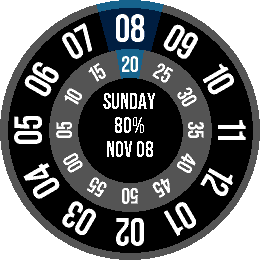
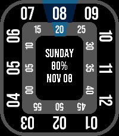

# Roto360 reimaged

A rotating-dial watchface for Pebble, redrawn from scratch for the Pebble Round 2's 260x260 color screen. It also runs on the Pebble Time, Time Round and Time 2.

 

This is an independent remake inspired by [Roto360](https://apps.repebble.com/roto360_5640028f39a14af5f100000f) by MicroByte. It shares no code, images or fonts with the original, and the original's author has not reviewed or endorsed it. The original has no published license, so nothing here grants rights to it, and its terms do not apply to this project.

## How it reads

The time sits under the blue shield at the top of the dial. The outer ring holds the hours and the inner ring holds the minutes in steps of five, and both rings turn so the current hour and minute stay under the shield. The minute box shows the exact minute. The center shows the weekday, battery level and date.

- Follows the watch's 12-hour or 24-hour setting. In 12-hour mode the hour ring reads 01 to 12.
- Battery turns red at 20% or below. While charging it shows a green `+`, for example `+80%`.
- Round watches draw circular rings. Rectangular watches draw a rounded-square bezel with the numbers running along the edges.
- The three center lines are vertically centered as a group. Font sizes and spacing keep the full weekday, including Wednesday, clear of the minute ring on every supported watch.
- A thin blue seconds marker travels clockwise around the edge of the center, with no number or text.
- A green arc on the outer bezel shows today's steps toward your daily goal. It runs clockwise from the right edge of the hour shield, stays full at or above the goal, and resets with the day's step total. Rectangular watches use the same rounded-square bezel. The inner seconds track and center text remain clear.

The rotated numerals come from a high-resolution atlas of Bebas Neue that the watch samples and antialiases as it draws, instead of scaling a small bitmap. That keeps them sharp at every angle on the larger screen.

| Watch | Platform | Shape |
|---|---|---|
| Pebble Round 2 | `gabbro` | round, 260x260 |
| Pebble Time Round | `chalk` | round, 180x180 |
| Pebble Time 2 | `emery` | rectangular, 200x228 |
| Pebble Time, Time Steel | `basalt` | rectangular, 144x168 |

Open the watchface's settings in the Pebble phone app to configure:

- **Daily step goal:** a whole number from 1 to 100,000; defaults to 8,000. This changes only the watchface's target, not Pebble Health's goal.
- **Seconds marker:** **Off**, **Always**, or **10 seconds after wrist shake / tap**. Existing on/off preferences are preserved; new installs default to Always. Shake mode shows seconds for 10 seconds after a detected gesture, then hides the marker and returns to minute ticks. Another gesture restarts that interval. Motion detection depends on the watch and is not guaranteed to match a wrist raise.

Enable Pebble Health in the Pebble phone app to supply steps. The face reads today's on-watch total, listens for Health updates, and checks again each minute, including after midnight. An amber dash at the bottom of the bezel means step data is unavailable; it is not shown as zero progress. No step or sleep data is sent to the phone or a server. The settings are saved on both the phone and watch and reapplied when they reconnect.

### Battery use

Off and idle shake mode subscribe to minute ticks, not hidden second ticks. Always and an active shake interval update each second. Seconds also pause when a notification covers the face; shake intervals are cancelled on focus loss. Step progress uses the existing Health service rather than a separate accelerometer step counter. Battery changes and changed step totals also trigger updates.

This follows Pebble's [battery guidance](https://developer.repebble.com/guides/best-practices/conserving-battery-life/): reduce wakeups, offer a seconds-off option, and limit animation to gestures. **Off** gives the fewest animation wakeups; shake mode is a compromise. The [Health guide](https://developer.repebble.com/guides/events-and-services/health/#detecting-activities) also suggests suppressing animation during detected sleep, but this face does not change seconds behavior based on sleep. Emulator checks do not measure real-watch battery life.

The small phone companion provides an embedded, offline settings page. It makes no network requests and needs no hosted page or third-party packages.

If the dial's resources or layer cannot be loaded, the face logs the failure and shows **ROTO360 ERROR / RESTART WATCHFACE** instead of a dial with missing time digits. Restart the face; if the error persists, reinstall it. A window allocation failure is logged but cannot display an error screen.

## Build and install

You need the [Pebble SDK](https://developer.repebble.com/sdk.md). The project CI uses Pebble CLI 5.0.40 with SDK 4.33.1. On Windows, use WSL.

```text
cd app
pebble build
pebble install --emulator gabbro
```

To install on a watch, enable the Developer Connection in the Pebble phone app and run `pebble install --phone <phone IP>`. Every CI run uploads a ready-built `Roto360Reimaged-<version>.pbw` as an artifact, and published releases attach the same file.

The face uses its own app UUID, so it installs next to the original Roto360 instead of replacing it.

## Tests

```text
npm test
```

This needs Node.js 22 or later and GCC or Clang. It builds the dial logic natively and checks the package settings, digit atlas and store images.

The tools in `tools/` need Python 3 and Pillow:

- `python3 tools/gen_digits.py` renders `app/resources/data/digits.bin` from the font. Add `--check` to confirm the committed atlas matches.
- `python3 tools/make_store_assets.py store/screenshots store` rebuilds the store banners and icons.

## Project structure

- `app/src/c/main.c`: layout, rings, shield and center text.
- `app/src/c/dial.c`: time, label and ring geometry logic with no SDK dependency.
- `app/src/pkjs/index.js`: offline phone settings for seconds mode and daily step goal.
- `app/src/c/numerals.c`: draws rotated, antialiased digits from the atlas.
- `store/`: emulator screenshots, banners and icons for the Pebble appstore.
- `tests/`: Node.js tests and the native dial test.

## Contributing and security

See [CONTRIBUTING.md](CONTRIBUTING.md) and [SECURITY.md](SECURITY.md). Contributor and AI-agent guidance lives in [.github/skills/pebble-development/SKILL.md](.github/skills/pebble-development/SKILL.md), which links to the official [Pebble AI agent guide](https://developer.repebble.com/guides/ai-agents.md).

## License

The code, drawings and store art are under the [Apache License 2.0](LICENSE). Bebas Neue is under the [SIL Open Font License 1.1](app/resources/fonts/OFL.txt); see [NOTICE](NOTICE).
